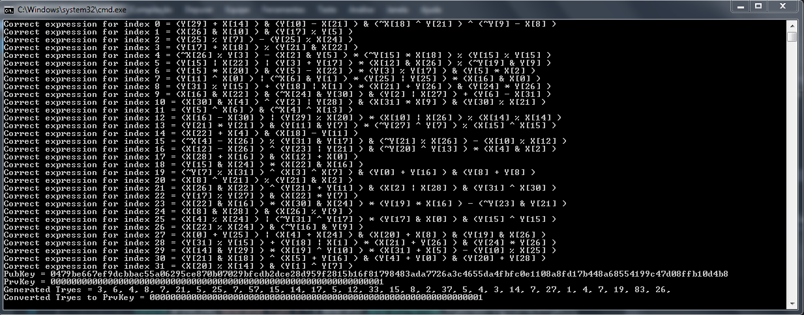
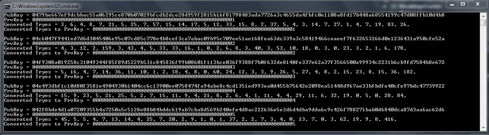

# BitcoinExprCracker

Este projeto é fruto de um estudo pessoal sobre o algoritmo Secp256k1. O objetivo dele é conseguir obter, usando apenas os 
valores da chave pública, o valor correto da chave privada.

O algortimo implementado, de forma pseudo-aleatória, gera expressões matemáticas usando os valores da chave pública que 
resultem no correto valor da chave privada em determinada posição.

Na figura abaixo um exemplo do algoritmo mostrando as expressões geradas para cada byte na chave privada:



Resultado usando como chave privada os valores de 1 à 5:



## Android — ExprCracker Lab

A pasta `android/` contém uma versão Android do estudo, redesenhada como app educacional/pesquisa local:

- **Key Studio**: geração efêmera de chaves secp256k1, WIF, endereços P2PKH/P2WPKH e assinaturas locais. Nada é salvo fora do dispositivo.
- **Expression Lab**: port do gerador de expressões pseudo-aleatórias. Ele só faz auto-teste quando você informa a chave privada; **não** deriva chave privada a partir de endereço/chave pública.
- **Toy Curve**: curva pequena `y² = x³ + x + 4` sobre `F₂₃` para visualizar brute-force de chave privada em um grupo finito de ordem 29.
- **Neural Lab**: MLP tiny totalmente local para um experimento didático em dados sintéticos de curva pequena; não é um modelo capaz de quebrar secp256k1.

### Build

Requisitos: JDK 17, Android SDK 34 e Gradle 8.9 (o projeto usa wrapper).

```bash
cd android
./gradlew :app:assembleDebug
./gradlew :app:testDebugUnitTest
```

APK de debug: `android/app/build/outputs/apk/debug/app-debug.apk`.

### Limites de segurança

Recuperar a chave privada de um endereço Bitcoin real a partir apenas da chave pública é o problema do logaritmo discreto em secp256k1 e é computacionalmente inviável. O app mantém essa fronteira explícita na UI para não prometer o impossível.
